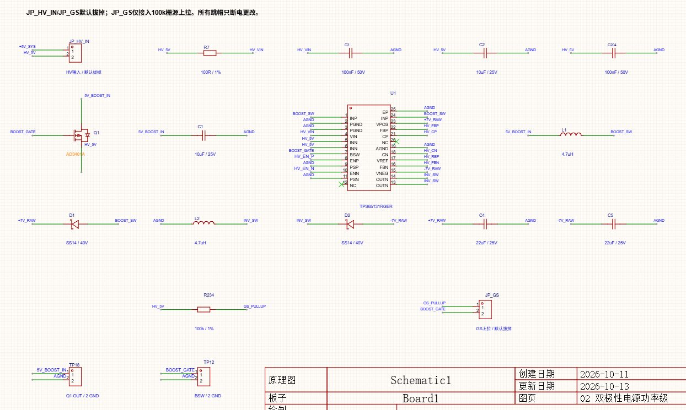
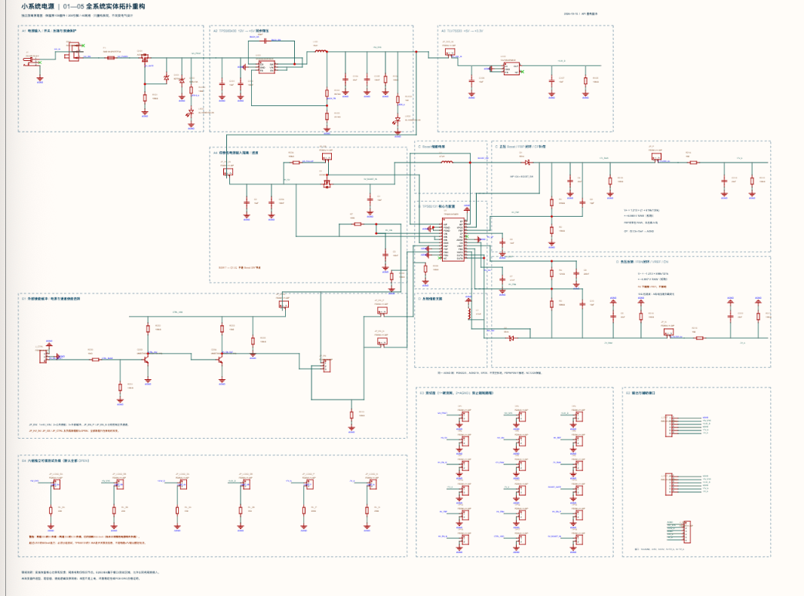

# Modular Schematic Layout · PCB Design Guidelines

同一仓库提供两个独立的电子设计 Agent Skill：

| Skill | 适用任务 | 核心关注 |
| --- | --- | --- |
| [modular-schematic-layout](modular-schematic-layout/SKILL.md) | 绘制、生成、重排和审查原理图 | 功能分组、拓扑可见、统一视觉语言、分页、文字归属和无遮挡 |
| [pcb-design-guidelines](pcb-design-guidelines/SKILL.md) | PCB 规划、布局、布线指导和板图审查 | 约束驱动的分区、关键回路与回流、层叠/阻抗、热、隔离、装配和制造 |

中文 · [English](README.en.md) · [Releases](https://github.com/Ausanx/modular-schematic-layout/releases)

两项 skill 可以分别安装。完整硬件流程通常先用原理图 skill 整理已确认的连接基线，再用 PCB skill 将器件、封装、机械和板厂约束落实到板级；原理图的美观或连通表达不能替代 PCB 的 DRC、阻抗、热和 DFM 检查。

## 原理图示例

<table>
  <tr>
    <th width="50%">使用前 · 元件和标签分散</th>
    <th width="50%">使用后 · 功能分区和可见拓扑</th>
  </tr>
  <tr>
    <td valign="top"></td>
    <td valign="top"></td>
  </tr>
</table>

图片用于展示组织方式变化，不证明逐引脚等价、ERC、PCB 或制造检查通过。原理图 skill 还包含独立合成的文字遮挡与字段归属评测，重点检查位号/数值紧随所属元件，且最终渲染没有文字、符号、导线或页边界遮挡。

## 安装

使用 [Skills CLI](https://github.com/vercel-labs/skills) 安装单项 skill：

~~~bash
# 原理图
npx skills add Ausanx/modular-schematic-layout --skill modular-schematic-layout

# PCB
npx skills add Ausanx/modular-schematic-layout --skill pcb-design-guidelines
~~~

安装到 Codex 全局目录：

~~~bash
npx skills add Ausanx/modular-schematic-layout --skill modular-schematic-layout --agent codex --global
npx skills add Ausanx/modular-schematic-layout --skill pcb-design-guidelines --agent codex --global
~~~

也可从同一 GitHub Release 下载独立的 `modular-schematic-layout.skill` 和 `pcb-design-guidelines.skill`。手动安装时，只复制所需目录及其 `SKILL.md` 和 `references/`，不要把另一个 skill 或评测夹具混入安装目录。

## 开始使用

原理图：

~~~text
$modular-schematic-layout
优化这份 KiCad 原理图的可读性。保留网表、器件、引脚和逻辑，
按真实功能组织主路径、支路、反馈、分页与统一标注；交付可编辑源、
渲染预览和实际执行的检查结果。
~~~

PCB：

~~~text
$pcb-design-guidelines
审查这份 PCB 的分区、关键电源回路、回流、层叠、阻抗、热、
隔离、装配和可制造性。先列出已知约束与缺失输入，再按证据给出
优先级建议，并区分已运行与未运行的 DRC、SI、热和 DFM 检查。
~~~

## 验证与边界

- 原理图 evals：见 [modular-schematic-layout/evals](modular-schematic-layout/evals/README.md)，包含 8 个布局、图像审查、SVG 绘制、分页、跨拓扑风格、接口映射和文字避让场景。
- PCB evals：见 [pcb-design-guidelines/evals](pcb-design-guidelines/evals/README.md)，覆盖电源回路/回流、混合信号与高速约束、机械/装配/测试/板厂限制。
- 两项 skill 都要求保留用户确认的网络、器件、封装、极性、隔离和机械身份；缺少数据时标出假设，不用整齐外观替代电气证据。
- 标准只作为适用范围和验证来源，不复制标准正文，也不代表自动符合标准或完成认证。参见[原理图标准索引](modular-schematic-layout/references/standards-and-sources.md)和[PCB 标准索引](pcb-design-guidelines/references/standards-and-sources.md)。
- 没有实际运行 ERC、DRC、阻抗场求解、热/载流计算、Gerber/DFM 或板厂检查时，输出不得写成“已通过”。

## 仓库结构

~~~text
modular-schematic-layout/
├── modular-schematic-layout/
│   ├── SKILL.md
│   ├── references/
│   └── evals/
├── pcb-design-guidelines/
│   ├── SKILL.md
│   ├── references/
│   └── evals/
├── README.md
└── README.en.md
~~~

仓库只公开通用技能、公开示例和合成评测；用户项目原理图、PDF、网表和私人审查内容不在仓库中。标准链接、问题反馈和发布版本见 [GitHub 仓库](https://github.com/Ausanx/modular-schematic-layout)。
